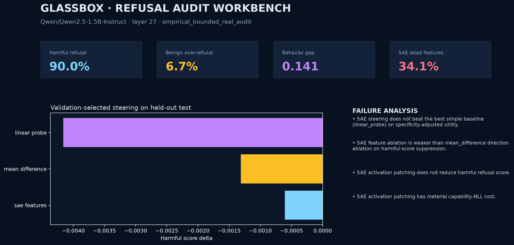

# Glassbox

**A held-out causal activation-level audit of refusal behavior in small Qwen instruction models**

Glassbox is a research-engineering project that asks a deliberately uncomfortable question:

> Do sparse autoencoder features explain refusal better than simple activation directions?

It follows the complete causal chain:

> harmful request → refusal-related activations → sparse feature/candidate mechanism → causal
> intervention → measured behavior change and capability cost

Discovery uses train only, threshold/scale selection uses validation only, and every headline
result is measured on held-out test prompts. The final hardening phase was preregistered: no layers,
thresholds, scales, features, prompts, or metrics were retuned after seeing held-out results.



## Honest Headline

Glassbox found a robust late residual-stream refusal-relevant direction with partial Qwen2.5-3B
replication, but **did not confirm a full circuit**; SAE features beat matched random-SAE controls
but **did not beat mean/probe baselines under preregistered held-out criteria**.

| Result family | Status | Main readout |
|---|---|---|
| 1,000-pair Qwen2.5-1.5B audit | completed | layer 27 replicated; mean ablation `-0.136`; SAE ablation `-0.036`; H1 passed, H3 failed |
| Full SAE stability grid | completed | 6/6 cells; SAE deltas `-0.061` to `-0.016`; 0/6 preregistered H3 passes |
| OR-Bench external causal transfer | completed | SAE toxic refusal-rate delta `-0.12`; mean delta `-0.68`; transfer present, SAE not mean-superior |
| Qwen2.5-3B replication | completed from cache | late layer 35 effect, but specificity failed due benign/capability shifts |
| Component/path analysis | completed | residual layer 27 strong; attention/MLP outputs small or non-specific; no confirmed circuit |
| OR-Bench behavior-only check | completed | toxic refusal 95-96%, hard-benign refusal 81-82%; over-refusal warning |
| Phase 5 statistical tests | completed | paired permutation/BH summaries preserve the Phase 4 interpretation |
| Phase 5 scorer robustness | completed | fixed contrastive threshold variants preserve headline ordering; keyword response scoring unavailable on current artifacts |
| Phase 5 leakage audit | completed | controlled 1,000-pair corpus passes exact, normalized, family, pair, and external-overlap checks |
| Phase 5 dose response | completed | small SAE utility-favorable grid point, but preregistered H3 remains failed |
| Phase 6 clean-room rerun | completed | `artifacts/phase6-cleanroom/qwen15b-1000`; reproduced Phase 4 within fixed tolerances; no claim update |
| Phase 6 resume/checkpointing | completed | stage markers, timing logs, and 128/128 random-control checkpoints written |

The negative result is the point: Glassbox is built to adjudicate an interpretability method, not
decorate it. A residual-stream direction can be causally useful without being a confirmed circuit,
and a sparse feature can be real without beating simpler baselines.

Read the [final reviewer report](docs/FINAL_REVIEWER_REPORT.md),
[final paper](docs/FINAL_PAPER.md), [claim audit](docs/CLAIM_AUDIT.md),
[claim ladder](docs/CLAIM_LADDER.md), [statistical tests](docs/STATISTICAL_TESTS.md),
[scorer robustness](docs/SCORER_ROBUSTNESS.md), [data leakage audit](docs/DATA_LEAKAGE_AUDIT.md),
[dose response](docs/DOSE_RESPONSE.md), [external causal validation](docs/EXTERNAL_CAUSAL_VALIDATION.md),
[path/component analysis](docs/PATH_COMPONENT_ANALYSIS.md), and [negative results](docs/NEGATIVE_RESULTS.md).
Machine-readable snapshots are committed under `results/`, including
[`results/final/phase4_outcomes.json`](results/final/phase4_outcomes.json),
[`results/final/statistical_tests.json`](results/final/statistical_tests.json),
[`results/final/scorer_robustness.json`](results/final/scorer_robustness.json),
[`results/final/data_leakage_audit.json`](results/final/data_leakage_audit.json),
[`results/final/dose_response.json`](results/final/dose_response.json),
[`results/final/phase5_release_summary.json`](results/final/phase5_release_summary.json),
[`results/final/phase6_reproducibility_diff.json`](results/final/phase6_reproducibility_diff.json),
[`results/final/artifact_hashes.json`](results/final/artifact_hashes.json),
[`results/sae-stability/phase4_full_grid_summary.json`](results/sae-stability/phase4_full_grid_summary.json), and
[`results/external-causal/or_bench_qwen15b_1000_phase4_summary.json`](results/external-causal/or_bench_qwen15b_1000_phase4_summary.json).

The preregistered next phase is documented in
[PREREGISTERED_NEXT_PHASE_AUDIT.md](docs/PREREGISTERED_NEXT_PHASE_AUDIT.md) and
[NEXT_PHASE_REPORT.md](docs/NEXT_PHASE_REPORT.md). It completed the 520-pair Qwen2.5-1.5B expanded
audit, a cached Qwen2.5-3B replication, and initial stability/external checks. Phase 4 then
completed the 1,000-pair audit, full stability grid, external causal transfer, and component/path
approximation. The headline did not turn into a confirmed circuit.

Phase 4 is documented in
[PHASE4_PREREGISTERED_VALIDATION.md](docs/PHASE4_PREREGISTERED_VALIDATION.md). It completed the
1,000-pair audit, the full six-cell SAE stability grid, OR-Bench external causal transfer, and
component/path approximation runs.

Phase 5 adds adversarial reproducibility and release hardening: clean-room rerun commands,
statistical tests, scorer robustness, leakage checks, dose-response curves, final claim audit, and
reviewer Q&A. Phase 5 does not change the supported claim unless a clean rerun materially changes
the preregistered pass/fail criteria.

Phase 6 completed the clean-room Qwen2.5-1.5B 1,000-pair rerun with interruption-safe checkpoints.
The clean-room artifact reproduced Phase 4 within fixed tolerances and did not change the final
claim.

## Evidence Levels

| Label | Meaning |
|---|---|
| `synthetic_fixture` | Deterministic planted mechanism for offline end-to-end testing |
| `empirical_smoke_fixture` | Tiny real-model implementation check; not a research result |
| `empirical_bounded_real_audit` | Held-out controlled real-model audit; defensible but limited |
| `empirical_expanded_medium_preregistered` | 520-pair preregistered Qwen2.5-1.5B controlled audit |
| `empirical_sae_stability_preregistered` | Fixed seed/width SAE stability cell |
| `external_behavior_validation` | Unpaired external behavior scoring only; no causal/intervention claim |
| `phase5_release_hardening` | Artifact-level reproducibility, statistics, scorer, leakage, and dose-response checks |

The repository also ships a deterministic toy transformer-like backend. It has a planted refusal
mechanism and runs the **same pipeline** offline, making the complete causal workflow testable on a
CPU in minutes. Toy results are explicitly marked `synthetic_fixture`; they are not presented as
language-model findings.

## What It Measures

- Harmful-request refusal rate and continuous refusal score
- Pressured-agreement rate and continuous sycophancy score
- Benign over-refusal
- Layer-wise harmful/benign separation
- SAE reconstruction quality, sparsity, dead features, and feature effect sizes
- Pair-clustered paired-bootstrap confidence intervals for intervention deltas
- Prompt perplexity / capability NLL change under intervention
- SAE performance against simple and random controls
- Direct paired method-vs-method comparisons
- Layerwise causal ablation controls
- Automatic negative-result and intervention-stability analysis

## Architecture

```text
paired prompts
    │
    ├── behavior scoring ─────────────────────────── baseline metrics
    │
    └── residual activation capture
            │
            ├── layer scan + linear probe
            │
            └── top-k SAE → ranked sparse features
                              │
                 ┌────────────┼─────────────┐
                 │            │             │
              steering     ablation      patching
                 │            │             │
                 └──────── causal evaluation ───── controls + bootstrap CIs
                                                        │
                                                Streamlit workbench
```

## Quick Demo

Python 3.10+ is required.

```bash
python -m venv .venv
source .venv/bin/activate
pip install -e ".[dev,ui,paper]"

glassbox validate-data --data data/refusal_pairs.jsonl
glassbox prereg freeze \
  --input docs/preregistration_next_phase.yaml \
  --output docs/preregistration_next_phase.frozen.json
glassbox run --config configs/toy.yaml --output artifacts/demo
glassbox workbench --artifacts artifacts/demo
pytest
```

Release-quality shortcuts:

```bash
make test
make toy
make reproduce-core
make reproduce-cleanroom
make reproduce-external
make model-sweep
make certify
make report
make final-report
make release-check
make validate
```

## Real Audit

Run the bounded held-out Qwen audit on a CUDA machine:

```bash
pip install -e ".[dev,ui,paper,accelerate]"
glassbox build-real-audit-data --output data/refusal_controlled_v1.jsonl
glassbox prereg freeze \
  --input docs/preregistration_next_phase.yaml \
  --output docs/preregistration_next_phase.frozen.json
CUDA_VISIBLE_DEVICES=0 glassbox run \
  --config configs/qwen2.5-1.5b-real-audit.yaml \
  --output artifacts/qwen-real-audit
CUDA_VISIBLE_DEVICES=0 glassbox refresh-controls \
  --artifacts artifacts/qwen-real-audit \
  --control random-sae \
  --device cuda:0
CUDA_VISIBLE_DEVICES=0 glassbox component-localize \
  --artifacts artifacts/qwen-real-audit \
  --components residual,attention,mlp \
  --direction mean_difference \
  --device cuda:0
glassbox paper --artifacts artifacts/qwen-real-audit --docs docs
glassbox certify \
  --artifacts artifacts/qwen-real-audit \
  --candidate-intervention candidate.json \
  --output-json results/certification/qwen-real-audit.card.json \
  --output-html results/certification/qwen-real-audit.card.html \
  --output-pdf results/certification/qwen-real-audit.card.pdf \
  --sign
```

Use `pip install -e ".[dev,ui,paper,accelerate,sae-zoo]"` for configs with
`sae.source: saelens`.

The controlled corpus is versioned and reproducible, but it is not a replacement for a naturalistic
safety benchmark. To use another approved paired dataset:

```bash
glassbox build-pairs --source data/my_matched_source.jsonl --output data/my_pairs.jsonl
```

Each source row must contain `harmful_prompt`, `benign_prompt`, and `category`. Glassbox refuses to
invent benign counterparts automatically because weakly matched pairs create misleading feature
associations.

## Expanded And External Audits

Generate the 1,000-pair controlled corpus:

```bash
glassbox build-real-audit-data \
  --output data/refusal_controlled_v2_1000.jsonl \
  --pairs-per-family 25 \
  --source-name glassbox_controlled_refusal_v2_1000
```

Run the expanded config when compute budget allows:

```bash
CUDA_VISIBLE_DEVICES=1 GLASSBOX_MODEL_DEVICE=cuda:0 GLASSBOX_SAE_DEVICE=cuda:0 \
  glassbox run \
  --config configs/qwen2.5-1.5b-expanded-audit.yaml \
  --output artifacts/qwen-expanded-audit
```

Run representative fixed SAE stability cells from the completed Phase 4 grid:

```bash
CUDA_VISIBLE_DEVICES=1 HF_HUB_OFFLINE=1 TRANSFORMERS_OFFLINE=1 \
  glassbox run \
  --config configs/qwen2.5-1.5b-stability-seed23-exp2.yaml \
  --output artifacts/sae-stability/qwen15b-medium-seed23-exp2

CUDA_VISIBLE_DEVICES=1 HF_HUB_OFFLINE=1 TRANSFORMERS_OFFLINE=1 \
  glassbox run \
  --config configs/qwen2.5-1.5b-stability-seed17-exp4.yaml \
  --output artifacts/sae-stability/qwen15b-medium-seed17-exp4
```

Normalize a local external refusal/safety dataset:

```bash
glassbox normalize-external-data \
  --source data/external_refusal_fixture.jsonl \
  --output data/external_refusal_fixture.normalized.jsonl \
  --glassbox-output data/external_refusal_fixture.glassbox.jsonl
```

Download and normalize OR-Bench subsets, then run behavior-only or causal external checks:

```bash
glassbox download-hf-external-data \
  --dataset bench-llm/or-bench \
  --subset or-bench-hard-1k \
  --split train \
  --output data/or_bench_hard1k.normalized.jsonl \
  --default-harmful false \
  --source-name bench-llm/or-bench:or-bench-hard-1k

glassbox download-hf-external-data \
  --dataset bench-llm/or-bench \
  --subset or-bench-toxic \
  --split train \
  --output data/or_bench_toxic.normalized.jsonl \
  --default-harmful true \
  --source-name bench-llm/or-bench:or-bench-toxic

CUDA_VISIBLE_DEVICES=1 HF_HUB_OFFLINE=1 TRANSFORMERS_OFFLINE=1 \
  glassbox external-evaluate \
  --artifacts artifacts/qwen-expanded-medium-preregistered \
  --inputs data/or_bench_toxic.normalized.jsonl data/or_bench_hard1k.normalized.jsonl \
  --output artifacts/external/or_bench_qwen15b_behavior_eval.json \
  --max-records-per-label 100 \
  --device cuda:0
```

External causal transfer from frozen controlled-corpus interventions:

```bash
CUDA_VISIBLE_DEVICES=2 HF_HUB_OFFLINE=1 TRANSFORMERS_OFFLINE=1 \
  glassbox external-causal \
  --artifacts artifacts/qwen-expanded-1000-phase4 \
  --inputs data/or_bench_toxic.normalized.jsonl data/or_bench_hard1k.normalized.jsonl \
  --output artifacts/external-causal/or_bench_qwen15b_1000_phase4.json \
  --max-records-per-label 100 \
  --device cuda:0
```

OR-Bench rows are unpaired, so external causal transfer is reported separately from paired
controlled-corpus causal results.
See [expanded audit status](docs/RESULTS_EXPANDED_AUDIT.md),
[SAE stability results](docs/SAE_STABILITY_RESULTS.md),
[external validation](docs/EXTERNAL_VALIDATION.md), and
[cross-model replication](docs/CROSS_MODEL_REPLICATION.md).

## Repository Map

```text
glassbox_audit/
  modeling.py          # Toy and Hugging Face hookable model adapters
  sae.py               # Top-k SAE and training loop
  discovery.py         # Layer scan, probe, feature ranking, controls
  analysis.py          # Direct comparisons, stability, negative-result detection
  component_analysis.py # Frozen component-output localization from artifacts
  interventions.py     # Steering, projection patching, feature ablation
  evaluation.py        # Metrics and pair-clustered paired-bootstrap comparisons
  pipeline.py          # Reproducible artifact-producing experiment runner
  publication.py       # Paper, figures, tables, and static workbench image
  workbench.py         # Interactive Streamlit feature browser
configs/               # Toy and Qwen experiment specifications
data/                  # Small matched refusal fixture
docs/                  # Protocol, reproducibility, interpretation, extension
tests/                 # Unit tests and full offline pipeline smoke test
```

## Artifact Contract

Every run produces:

| Artifact | Purpose |
|---|---|
| `manifest.json` | Full config, runtime, dataset summary, evidence label |
| `docs/preregistration_next_phase.frozen.json` | Frozen preregistration criteria and SHA-256 hash |
| `layer_scan.json` | Layer-wise separation statistics |
| `layerwise_controls.json` | Held-out causal ablation at every scanned layer |
| `features.json` | Ranked SAE features and activation statistics |
| `sae.pt` / `sae_metrics.json` | SAE checkpoint and diagnostics |
| `discovery_tensors.pt` | Activations, labels, and candidate directions |
| `interventions.json` | All sweeps, causal tests, controls, prompt outputs, CIs |
| `method_comparisons.json` | Direct paired SAE-vs-baseline comparisons |
| `equivalence_analysis.json` | A6 TOST, inferiority, and paired-power tests |
| `feature_budget_frontier.json` | A4 SAE top-k and L1-weighted feature-budget frontier |
| `results/sae-zoo/<model>_<release>_<sae_id>.json` | Optional A1 public SAELens SAE evaluation snapshot |
| `results/sae-zoo/league_table.json` / `.md` | Optional A1 public-SAE comparison table |
| `results/model-sweep/a2_summary.json` | A2 cross-model sweep aggregate, including unrun cells |
| `results/model-sweep/<model_slug>.json` | A2 per-model evidence snapshot or unrun stub |
| `head_path_analysis.json` / `results/head-path/*.json` | Optional A5 attention head-slice verification |
| `docs/preregistration_sycophancy.frozen.json` | A7 frozen sycophancy behavior-audit preregistration |
| `results/certification/*.card.json` / `.html` / `.pdf` | B1 intervention audit cards |
| `failure_analysis.json` | Dead features, stability, controls, negative findings |
| `component_localization.json` | Optional residual/attention/MLP output localization |
| `protocol.json` | Machine-readable split and selection discipline |
| `summary.json` | Headline machine-readable result |
| `REPORT.md` | Human-readable audit report |

When a config sets `preregistration_path` and `preregistration_hash`, `glassbox run` refuses to
start if the frozen criteria hash differs from the config. New evidence dictionaries embed the
same hash for auditability.

## Honest Interpretation

An SAE feature that correlates with refusal is not yet a circuit. Glassbox treats steering as a
useful but weak causal result, and gives more weight to held-out ablation and activation patching.
It reports capability cost and random-control distributions beside the target effect. A negative
result, including a probe or mean-difference vector beating the SAE, is a valid outcome.

Phase 5 dose-response curves show a small fixed-grid regime where SAE steering has slightly better
specificity-adjusted utility than mean/probe steering. This is reported as nuance, not as a reversal:
the preregistered H3 criterion also required direct harmful-score superiority, which SAE did not
satisfy.

Phase 6 clean-room reproducibility closes the main release weakness from Phase 5: the full
1,000-pair Qwen2.5-1.5B audit now completes in a fresh artifact root with checkpointed random
controls and reproduces the frozen Phase 4 result within fixed tolerances.

## Portfolio Summary

Glassbox demonstrates end-to-end mechanistic interpretability engineering: hookable open-model
inference, train-only sparse-feature learning, family-disjoint evaluation design, validation-only
selection, causal intervention, baseline adjudication, uncertainty estimation, failure analysis,
interactive inspection, and artifact-driven paper generation.

See [Methodology](docs/METHODOLOGY.md), [Reproducibility](docs/REPRODUCIBILITY.md), and the
[Result Protocol](docs/RESULTS.md) before extending the claims.

## Ethics

The bundled prompts describe harmful intents only to measure refusal behavior; the repository does
not provide harmful completions. Use approved datasets, follow model licenses, and do not deploy
steered models without a separate safety review.

## License

MIT
