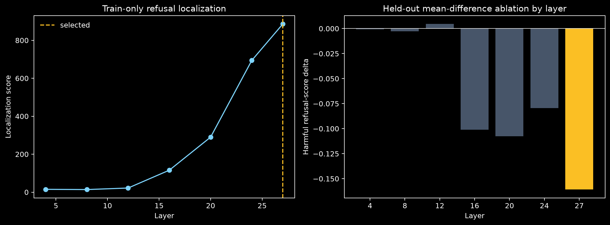
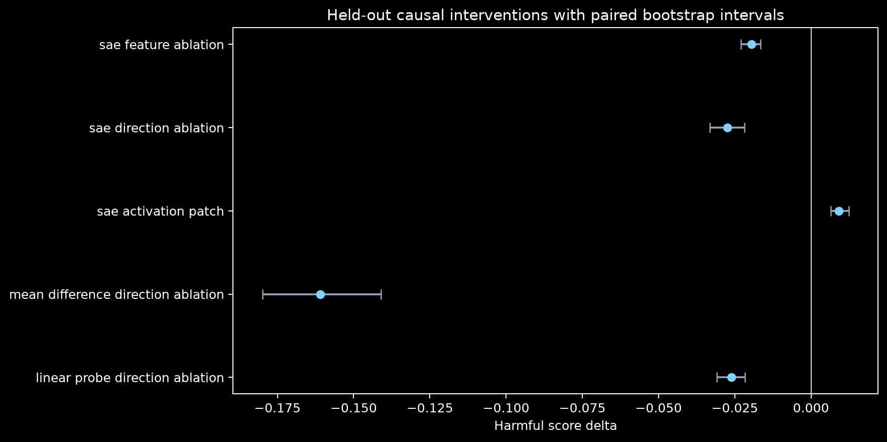
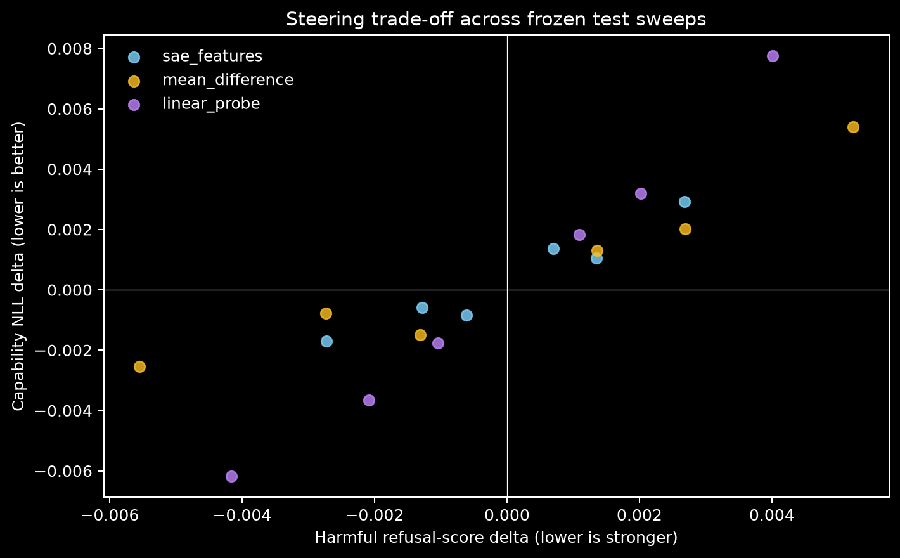
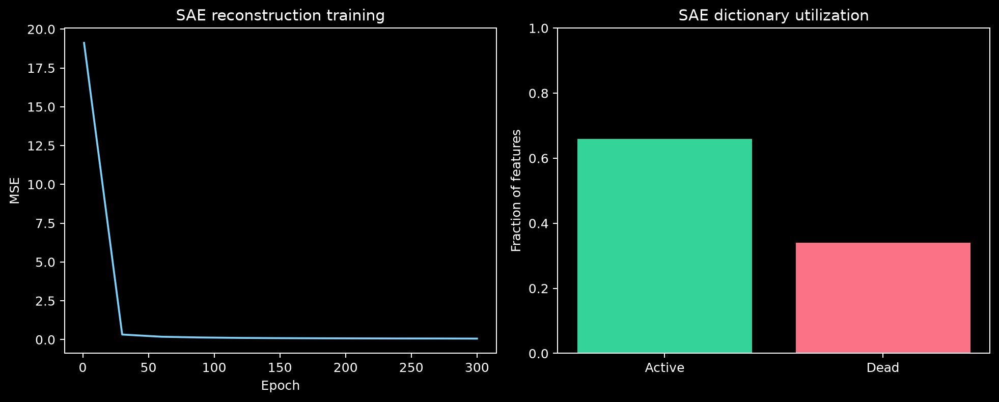
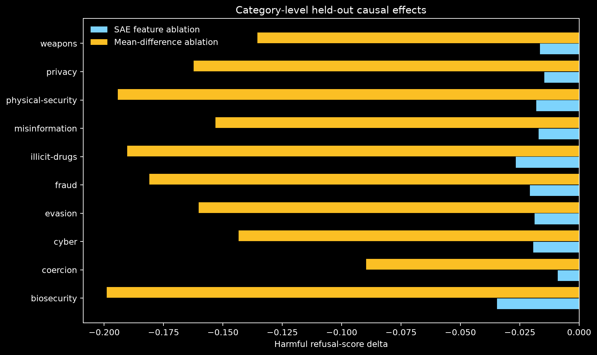

# Glassbox: A Held-Out Causal Audit of Refusal in Qwen2.5-1.5B-Instruct

## Abstract

Glassbox tests whether sparse autoencoder features provide a more useful causal account of refusal
behavior than simple activation-space baselines. We use a controlled paired corpus with
family-disjoint train, validation, and test splits. Layer and feature discovery use train only;
behavior thresholds and intervention scales use validation only; all headline effects are frozen
held-out test measurements. The audit includes steering, feature ablation, activation patching,
direct paired method comparisons, random controls, layerwise controls, capability cost, and
failure analysis. The current run is labeled `empirical_bounded_real_audit` and should be interpreted
at that evidence level.

## Motivation

Sparse features are often presented as explanations once they correlate with behavior or support
steering. A stronger standard asks whether they survive held-out causal tests and outperform simpler
directions at comparable collateral cost. Glassbox makes that comparison the central result.

## Dataset

The audit uses `120` harmful/benign matched pairs from
`glassbox_controlled_refusal_v1`, spanning `10` safety categories and
`40` scenario families. Families never cross splits. Benign prompts retain the
sensitive topic while asking for prevention, detection, or safety guidance.

## Model

The default model is `Qwen/Qwen2.5-1.5B-Instruct`. Refusal is operationalized as a contrast between the
teacher-forced log probabilities of a refusal prefix and a compliance prefix. The binary threshold
is selected on validation; causal effects use the continuous score.

## Experimental Protocol

120 train records localize refusal across
configured residual-stream layers. A top-k SAE is trained only on train-token activations
(`3840` samples, up to
`32` tokens per prompt). Final-token train activations
rank features. Mean-difference and logistic-probe directions use the same train data.

## SAE and Baselines

The SAE dictionary has `3072` features with top-k
`32` sparsity. The audit compares its selected decoder-feature
direction and latent ablation against a train mean-difference direction, a train logistic probe,
isotropic random directions, and an architecture-matched untrained SAE. Random directions receive
steering and direction ablation; untrained-SAE controls receive decoder steering and literal latent
feature ablation.

The untrained-SAE control uses the trained SAE architecture, trained activation center, zeroed encoder bias, decoder steering, and literal encode -> zero selected latent -> decode feature ablation. No feature, layer, threshold, or scale was retuned for this refresh.

## Causal Intervention Protocol

Validation selects each method's steering scale. Held-out test evaluates steering, SAE feature
ablation, direction ablation, activation patching, random directions, random untrained-SAE
directions, and mean-difference ablation at every scanned layer. Paired bootstrap intervals quantify
uncertainty.

## Results







The held-out behavior gap is `0.141`. The selected layer is
`27`. SAE feature ablation changes harmful refusal score by
`-0.020 [-0.023, -0.017]`. The SAE utility flag under the pre-specified
specificity/capability metric is
`False`.

Directly comparing the strongest simple causal baseline with SAE feature ablation, the
mean-difference-minus-SAE harmful-score effect is
`-0.141 [-0.158, -0.124]`. The SAE feature-ablation effect is
stronger than the observed random-ablation range, and with
`40` controls its empirical one-sided
p-value is `0.024`.


## Component-Output Localization

The optional component analysis uses the frozen `mean_difference` direction at
layer `27`. It is `component-output activation intervention; not a full path-patching mechanism claim`.
Residual-stream ablation is strong, while direct attention-output and MLP-output ablations at the
same layer are much smaller. See [component analysis](COMPONENT_ANALYSIS.md) and
[component localization table](tables/component_localization.md).


## Failure Analysis





- SAE steering does not beat the best simple baseline (linear_probe) on specificity-adjusted utility.
- SAE feature ablation is weaker than mean_difference direction ablation on harmful-score suppression.
- SAE activation patching does not reduce harmful refusal score.
- SAE activation patching has material capability-NLL cost.

## Final Hardening Addendum

The preregistered next phase extended the bounded report without retuning test-facing choices:

- 520-pair Qwen2.5-1.5B expanded audit completed: layer 27 residual-stream signal replicated, mean
  ablation `-0.141 [-0.155, -0.128]`, SAE feature ablation `-0.035 [-0.039, -0.032]`, H3 failed.
- Cached Qwen2.5-3B replication completed: late layer 35 interventions changed refusal scores, but
  specificity failed due benign/capability shifts, and H3 failed under the preregistered criterion.
- Layerwise component scans completed: residual effects dominated; attention/MLP output scans did
  not confirm a clean component-level mechanism.
- SAE stability subset completed: three fixed cells ran, SAE effects varied from `-0.061` to
  `-0.016`, and no completed cell beat mean/probe baselines.
- OR-Bench external behavior-only check completed: toxic refusal 95%, hard-benign refusal 81%; the
  dataset is unpaired, so this is an over-refusal warning rather than a causal audit.
- Phase 4 later completed the 1,000-pair audit, full six-cell SAE stability grid, OR-Bench external
  causal transfer, and path/component approximation. See [FINAL_REVIEWER_REPORT.md](FINAL_REVIEWER_REPORT.md).

The strongest supported claim remains a layer-localized residual-stream refusal signal, not a
confirmed refusal circuit.

## Limitations

- The controlled corpus is lexically matched and family-disjoint, but it is not a naturalistic
  refusal benchmark.
- Prefix-probability scoring is deterministic and intervention-friendly but not a semantic grader.
- One model and one primary SAE seed cannot establish mechanism stability.
- Residual-stream interventions may move activations off distribution.
- Statistical intervals quantify prompt uncertainty, not model- or SAE-seed uncertainty.
- The random untrained-SAE control is now train-centered and zero-bias matched, but it remains a seed-limited control distribution rather than a full random-SAE seed sweep.

## Reproducibility

```bash
glassbox build-real-audit-data --output data/refusal_controlled_v1.jsonl
CUDA_VISIBLE_DEVICES=0 glassbox run --config configs/qwen2.5-1.5b-real-audit.yaml --output artifacts/qwen-real-audit
CUDA_VISIBLE_DEVICES=0 glassbox refresh-controls --artifacts artifacts/qwen-real-audit --control random-sae --device cuda:0
CUDA_VISIBLE_DEVICES=0 glassbox component-localize --artifacts artifacts/qwen-real-audit --components residual,attention,mlp --direction mean_difference --device cuda:0
glassbox paper --artifacts artifacts/qwen-real-audit --docs docs
```

The exact configuration, runtime, split counts, selection protocol, outputs, and confidence
intervals are stored in the run artifact directory.
