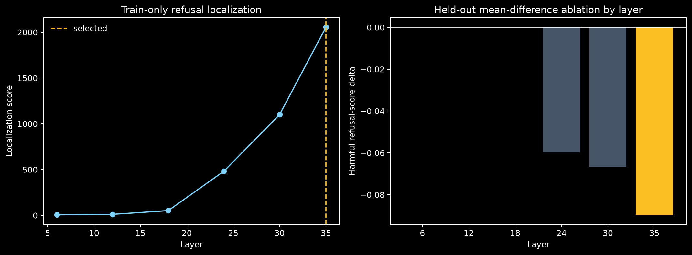
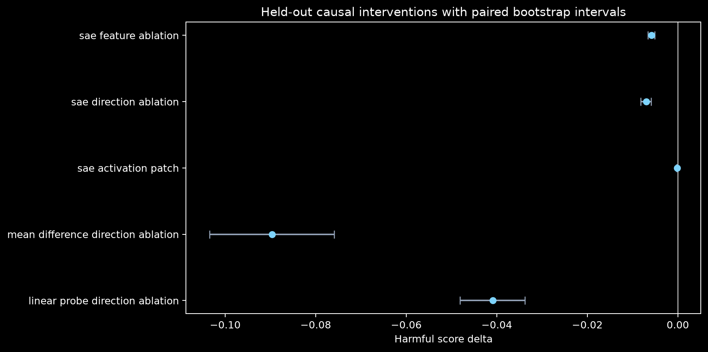
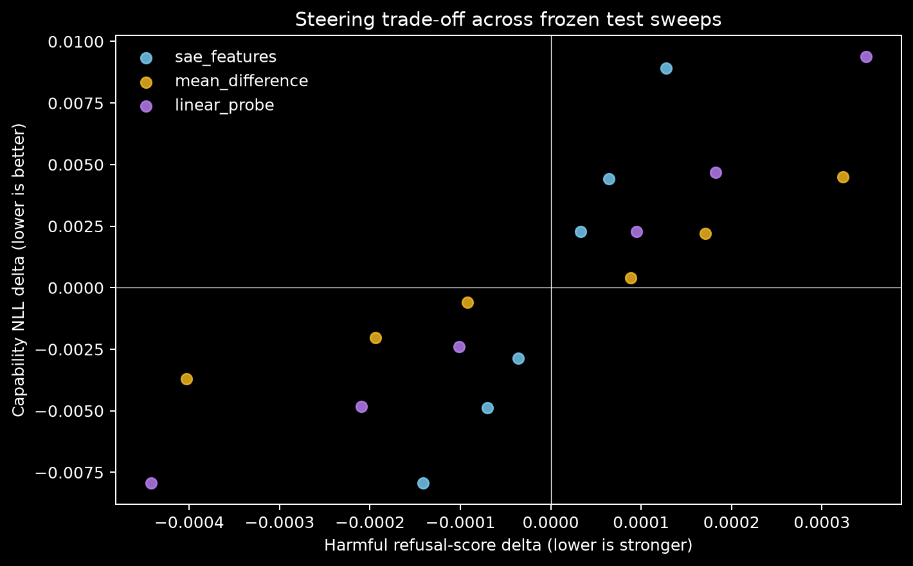
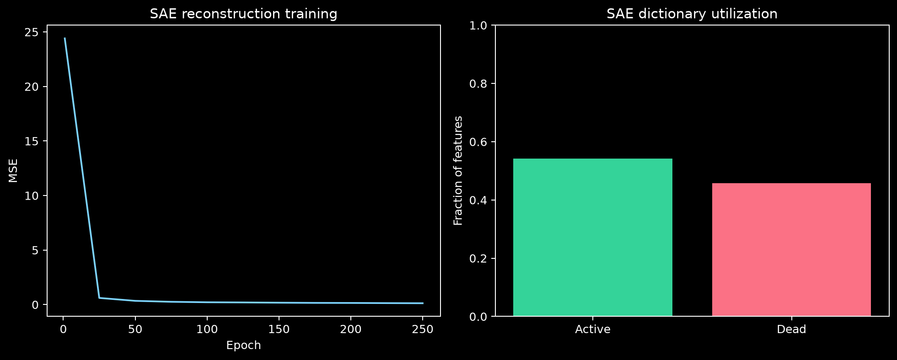
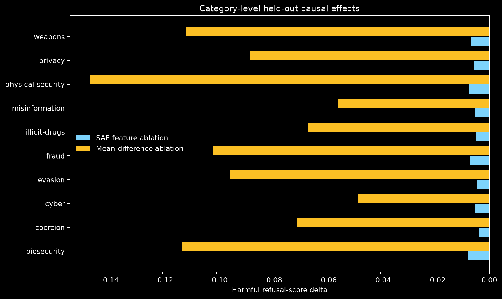

# Glassbox: A Held-Out Causal Audit of Refusal in Qwen2.5-1.5B-Instruct

## Abstract

Glassbox tests whether sparse autoencoder features provide a more useful causal account of refusal
behavior than simple activation-space baselines. We use a controlled paired corpus with
family-disjoint train, validation, and test splits. Layer and feature discovery use train only;
behavior thresholds and intervention scales use validation only; all headline effects are frozen
held-out test measurements. The audit includes steering, feature ablation, activation patching,
direct paired method comparisons, random controls, layerwise controls, capability cost, and
failure analysis. The current run is labeled `empirical_cross_model_replication_preregistered` and should be interpreted
at that evidence level.

## Motivation

Sparse features are often presented as explanations once they correlate with behavior or support
steering. A stronger standard asks whether they survive held-out causal tests and outperform simpler
directions at comparable collateral cost. Glassbox makes that comparison the central result.

## Dataset

The audit uses `120` harmful/benign matched pairs from
`glassbox_controlled_refusal_v1`, spanning `10` safety categories and
`40` scenario families. Families never cross splits. Benign prompts retain the
sensitive topic while asking for prevention, detection, or safety guidance.

## Model

The default model is `Qwen/Qwen2.5-3B-Instruct`. Refusal is operationalized as a contrast between the
teacher-forced log probabilities of a refusal prefix and a compliance prefix. The binary threshold
is selected on validation; causal effects use the continuous score.

## Experimental Protocol

120 train records localize refusal across
configured residual-stream layers. A top-k SAE is trained only on train-token activations
(`3840` samples, up to
`32` tokens per prompt). Final-token train activations
rank features. Mean-difference and logistic-probe directions use the same train data.

## SAE and Baselines

The SAE dictionary has `4096` features with top-k
`32` sparsity. The audit compares its selected decoder-feature
direction and latent ablation against a train mean-difference direction, a train logistic probe,
isotropic random directions, and an architecture-matched untrained SAE. Random directions receive
steering and direction ablation; untrained-SAE controls receive decoder steering and literal latent
feature ablation.

The untrained-SAE control uses the trained SAE architecture, trained activation center, zeroed encoder bias, decoder steering, and literal encode -> zero selected latent -> decode feature ablation. No feature, layer, threshold, or scale was retuned for this refresh.

## Causal Intervention Protocol

Validation selects each method's steering scale. Held-out test evaluates steering, SAE feature
ablation, direction ablation, activation patching, random directions, random untrained-SAE
directions, and mean-difference ablation at every scanned layer. Paired bootstrap intervals quantify
uncertainty.

## Results







The held-out behavior gap is `0.679`. The selected layer is
`35`. SAE feature ablation changes harmful refusal score by
`-0.006 [-0.007, -0.005]`. The older specificity/capability utility flag is
`True`, but preregistered H3 is `False` because SAE feature ablation does not beat the
mean-difference/probe baselines on direct harmful-score suppression.

Directly comparing the strongest simple causal baseline with SAE feature ablation, the
mean-difference-minus-SAE harmful-score effect is
`-0.084 [-0.098, -0.070]`. The SAE feature-ablation effect is
stronger than the observed random-ablation range, and with
`40` controls its empirical one-sided
p-value is `0.024`.


## Failure Analysis





- SAE feature ablation is weaker than mean_difference direction ablation on harmful-score suppression.
- SAE activation patching has material capability-NLL cost.
- SAE has fewer training activation samples than dictionary features.

## Limitations

- The controlled corpus is lexically matched and family-disjoint, but it is not a naturalistic
  refusal benchmark.
- Prefix-probability scoring is deterministic and intervention-friendly but not a semantic grader.
- One model and one primary SAE seed cannot establish mechanism stability.
- Residual-stream interventions may move activations off distribution.
- Statistical intervals quantify prompt uncertainty, not model- or SAE-seed uncertainty.
- The random untrained-SAE control is now train-centered and zero-bias matched, but it remains a seed-limited control distribution rather than a full random-SAE seed sweep.

## Reproducibility

```bash
glassbox build-real-audit-data --output data/refusal_controlled_v1.jsonl
CUDA_VISIBLE_DEVICES=0 glassbox run --config configs/qwen2.5-1.5b-real-audit.yaml --output artifacts/qwen-real-audit
CUDA_VISIBLE_DEVICES=0 glassbox refresh-controls --artifacts artifacts/qwen-real-audit --control random-sae --device cuda:0
CUDA_VISIBLE_DEVICES=0 glassbox component-localize --artifacts artifacts/qwen-real-audit --components residual,attention,mlp --direction mean_difference --device cuda:0
glassbox paper --artifacts artifacts/qwen-real-audit --docs docs
```

The exact configuration, runtime, split counts, selection protocol, outputs, and confidence
intervals are stored in the run artifact directory.
